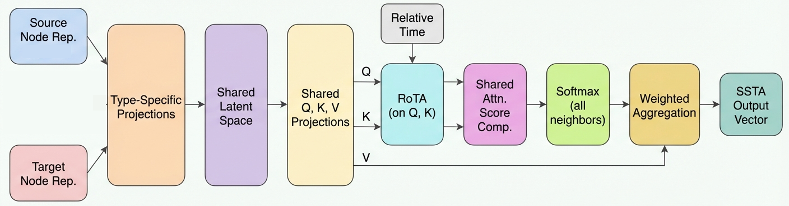
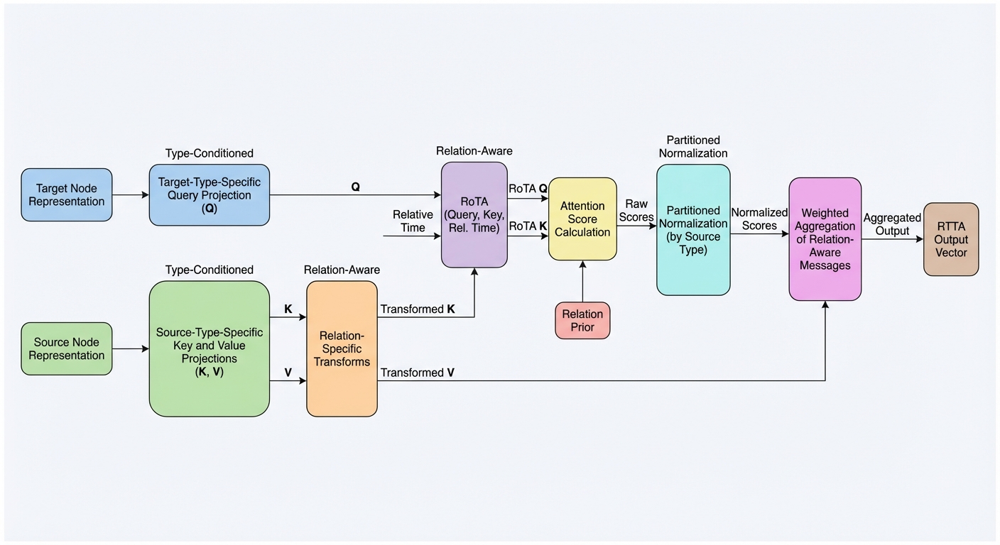

# THGFM: Dual-Branch Temporal Heterogeneous Graph Fusion Model

<!-- [](https://iswc2026.semanticweb.org/) -->
<!-- [](https://arxiv.org/abs/xxxx.xxxxx) -->
[](LICENSE)
[](https://www.python.org/)
[](https://pytorch.org/)

Official implementation of the paper:

> **Dual-Branch Temporal Heterogeneous Graph Fusion Model**
>
> *Anonymous Authors*
>
> 

<!-- TODO: Uncomment and update after camera-ready -->
<!-- > [[Paper]](https://arxiv.org/abs/xxxx.xxxxx) [[Slides]](link) [[Poster]](link) -->

## Overview

**THGFM** addresses the challenge of learning on **temporal heterogeneous graphs**, where node types, relation types, and timestamps jointly govern interaction patterns. It introduces a **dual-branch fusion mechanism** that separates complementary views of temporal structure and fuses them through heterogeneous graph convolutions with temporal encoding.

<p align="center">
  
  <br>
  <em>Figure 1: Overall architecture of THGFM. Each layer contains parallel SSTA and RTTA branches for temporal heterogeneous message passing with RoTA, fused through DRSF before passing to the next layer.</em>
</p>

### Key Components

<p align="center">
  
  &nbsp;&nbsp;
  
  <br>
  <em>Figure 2: (Left) SSTA — Shared-Space Temporal Attention branch for cross-type transfer. (Right) RTTA — Relation-Type Temporal Attention branch for relation-aware aggregation.</em>
</p>

<p align="center">
  
  <br>
  <em>Figure 3: DRSF (Dual-Path Relational-Shared Fusion) mechanism (NGLF, NGSF / TC-NGLF, TC-NGSF).</em>
</p>

## Repository Structure

```
THGFM/
├── HTAG/                  # HTAG benchmark (ArXiv & DBLP paper-venue)
│   ├── data_preprocess/   # Graph construction from raw pickles
│   ├── THGFM/             # Model, convolution, and data modules
│   ├── trainers/main/     # Training scripts and task pools
│   └── evaluator/         # Evaluation scripts
├── OAG/                   # OAG-CS benchmark (PV, PF-L1/L2)
│   ├── data_preprocess/
│   ├── THGFM/
│   ├── trainers/main/
│   └── evaluator/
├── OGBN/                  # OGBN-MAG node property prediction
│   ├── data_preprocess/
│   ├── THGFM/
│   ├── trainers/main/
│   └── evaluator/
├── Best_Model_Save/       # Pre-trained checkpoints (6 tasks)
├── scripts/               # Unified evaluation launcher
├── requirements.txt
└── environment.yml
```

## Requirements

- Python 3.11
- PyTorch 2.4.0 (CUDA 12.1)
- PyTorch Geometric 2.7.0
- DGL 2.4.0+cu121
- OGB >= 1.3.6

See [requirements.txt](requirements.txt) for full dependency pins.

## Installation

```bash
# Option 1: pip (recommended; requires CUDA 12.1)
pip install -r requirements.txt

# Option 2: Conda
conda env create -f environment.yml
conda activate thgfm
```

**Verify installation:**

```bash
python -c "import torch, torch_geometric; print(torch.cuda.is_available())"
```

## Dataset Preparation

> **Note on embeddings:** All preprocessing follows the encoders and pipelines defined by each baseline or the original dataset specification to ensure fair comparison with baseline work.

### HTAG (ArXiv & DBLP)

1. Download upstream pickles from [HTAG](https://github.com/Cloudy1225/HTAG/tree/main) and place them in `data/HTAG/{dblp,arxiv}/`.
2. Build graphs and shared bases:

```bash
cd HTAG/DBLP_PV/data_preprocess
python build_dblp_graph_from_pkl.py
python build_shared_pv_base.py

cd ../../Arxiv_PV/data_preprocess
python build_arxiv_graph_from_pkl.py
python build_shared_pv_base.py
```

### OAG-CS

1. Download raw MAG CS TSVs from [Google Drive](https://drive.google.com/open?id=1yDdVaartOCOSsQlUZs8cJcAUhmvRiBSz) into `data/raw_data/MAG_0919_CS/`.
2. Build graphs and shared bases:

```bash
cd OAG
python data_preprocess/preprocess_OAG_XLNet.py
python data_preprocess/build_shared_pv_base.py
python data_preprocess/build_shared_pf_base.py
python data_preprocess/build_shared_ad_base.py
```

See `OAG/data_preprocess/README.md` for detailed options.

### OGBN-MAG

1. Download the official [ogbn-mag](https://ogb.stanford.edu/docs/nodeprop/#ogbn-mag) dataset into `data/ogbn_mag/`.
2. Build graphs and shared bases:

```bash
python OGBN/data_preprocess/preprocess_ogbn_mag_w2v.py \
  --ogbn_mag_dir data/ogbn_mag --output_dir OGBN/data

python OGBN/data_preprocess/build_shared_pv_base_ogbn_mag.py
```

## Training

Always `cd` into the corresponding benchmark directory (`HTAG/`, `OAG/`, or `OGBN/`) before running training scripts.

```bash
# HTAG / DBLP paper-venue
cd HTAG
python DBLP_PV/train_paper_venue_shared.py \
  --shared_base_dir ./DBLP_PV/data/shared_pv_base_HTAG_dblp \
  --model_dir ./model_save_shared \
  --task_name HTAG_DBLP_rtta_s43 \
  --conv_name rtta --cuda 0 --seed 43 --deterministic

# OAG / paper-venue
cd OAG
python trainers/main/train_paper_venue_shared.py \
  --shared_base_dir ../data/shared_pv_base_CS_XLNet \
  --model_dir ./model_save_shared \
  --task_name PV_XLNet_rtta_s43 \
  --conv_name rtta --cuda 0 --seed 43 --deterministic

# OGBN-MAG
cd OGBN
python trainers/main/train_paper_venue_shared.py \
  --shared_base_dir ./data/shared_pv_base_ogbn_mag_graph \
  --model_dir ./model_save_shared \
  --task_name PV_ogbn_mag_rtta_s43 \
  --conv_name rtta --cuda 0 --seed 43 --deterministic
```

Use `--help` on each script for the full argument list. Multi-seed and distributed training are supported via `trainers/main/start_task_pool.sh`; see per-benchmark README files for details.

[Weights & Biases](https://wandb.ai/) logging is available with `--use_wandb`.

## Evaluation

### Per-benchmark evaluation

```bash
# HTAG
cd HTAG
python evaluator/eval_pv_htag_dblp.py --checkpoint /path/to/checkpoint.pt --cuda 0

# OAG (nDCG & MRR)
cd OAG
python evaluator/eval_pv_test_ndcg_mrr.py \
  --checkpoint /path/to/checkpoint --shared_base_dir ../data/shared_pv_base_CS_XLNet --cuda 0

# OGBN-MAG (official OGB accuracy)
cd OGBN
python evaluator/eval_test_accuracy.py \
  --checkpoint /path/to/checkpoint \
  --shared_base_dir ./data/shared_pv_base_ogbn_mag_graph \
  --splits valid,test --seed 43 --batch_size 256 --cuda 0
```

### Reproducing paper results with pre-trained checkpoints

Six pre-trained checkpoints are provided in `Best_Model_Save/` (HTAG ArXiv + DBLP, OAG PV + PF-L1 + PF-L2, OGBN-MAG PV). A unified evaluation script runs all benchmarks:

```bash
# Full evaluation (3 seeds)
python scripts/eval_best_model_save.py --seeds 43,44,45 --cuda 0

# Quick smoke test
python scripts/eval_best_model_save.py --smoke --seeds 43 --cuda 0

# Dry run (print commands without executing)
python scripts/eval_best_model_save.py --dry-run --seeds 43,44
```

Results are saved as JSON under `Best_Model_Save/eval_results/`. Use `--max-workers` to control GPU parallelism.

<!-- ## Main Results -->

<!-- TODO: Add main results table from paper -->
<!-- | Benchmark | Task | Metric | THGFM | Best Baseline |
|-----------|------|--------|-------|---------------|
| HTAG | DBLP PV | Accuracy | xx.x | xx.x |
| HTAG | ArXiv PV | Accuracy | xx.x | xx.x |
| OAG-CS | Paper-Venue | nDCG | xx.x | xx.x |
| OAG-CS | Paper-Field L1 | nDCG | xx.x | xx.x |
| OAG-CS | Paper-Field L2 | nDCG | xx.x | xx.x |
| OGBN-MAG | Node Classification | Accuracy | xx.x | xx.x | -->

## Citation

If you find this work useful, please cite our paper:

```bibtex
@inproceedings{thgfm2026,
  title     = {Dual-Branch Temporal Heterogeneous Graph Fusion Model},
  author    = {Anonymous},
  booktitle = {Proceedings of xxx},
  year      = {2026}
}
```

<!-- TODO: Update BibTeX after camera-ready with full author list and page numbers -->

## Acknowledgments

This codebase builds upon the following open-source projects:

- [PyTorch Geometric](https://github.com/pyg-team/pytorch_geometric)
- [DGL](https://github.com/dmlc/dgl)
- [OGB](https://ogb.stanford.edu/)
- [HTAG](https://github.com/Cloudy1225/HTAG)

## License

This project is licensed under the [MIT License](LICENSE).
